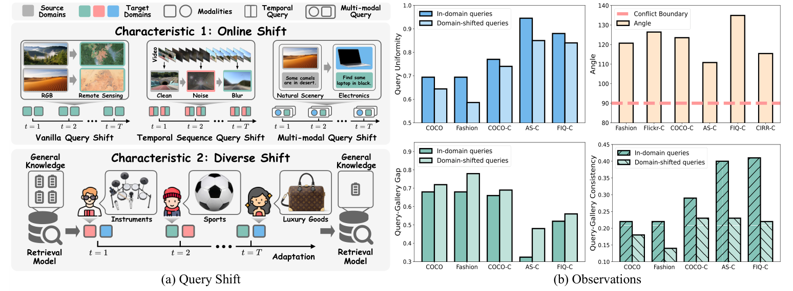
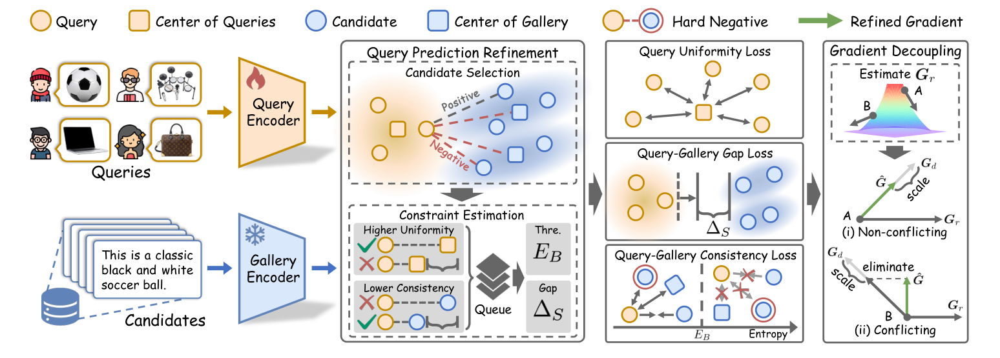

<h1 align="center">REST</h1>

<p align="center"><strong>Toward Robust and Harmonious Adaptation for Cross-modal Retrieval</strong></p>

<p align="center">Haobin Li · Zhuqi Liu · Mouxing Yang · Xi Peng</p>

<p align="center">
  <a href="https://doi.org/10.1109/TPAMI.2026.3729221"></a>
  <a href="https://doi.org/10.1109/TPAMI.2026.3729221"></a>
  <a href="https://drive.google.com/drive/folders/17QyJ9Y52XB67jektNvhUk6jKmIQnoatF?usp=drive_link"></a>
  <a href="https://drive.google.com/drive/folders/1tVuNY9l520BY6SvDdzzmNhF_wCrIaUei?usp=drive_link"></a>
  <a href="https://hbinli.github.io/TCR/"></a>
</p>

Official implementation of **REST**, published in *IEEE Transactions on Pattern Analysis and Machine Intelligence* (2026). This repository provides evaluation code for image–text, video–audio, and composed image retrieval.

## 🔍 Overview

Cross-modal retrieval matches a query in one modality to relevant items in another. In practice, queries arrive online and may differ from the data used to train the model. REST studies two settings: **Online Query Shift (OQS)**, where queries face an individual shift, and **Diverse Query Shift (DQS)**, where different shifts appear in the same stream.

<p align="center"></p>

## 🧭 From TCR to REST

Our earlier work, [**TCR** (ICLR 2025)](https://hbinli.github.io/TCR/) ([paper](https://openreview.net/pdf?id=BmG88rONaU), [code](https://github.com/XLearning-SCU/2025-ICLR-TCR)), introduced test-time adaptation for image–text retrieval under query shift. **REST (IEEE TPAMI 2026)** extends this line of work to diverse query streams and a broader set of cross-modal retrieval tasks, including video–audio and composed image retrieval.

## 🧠 Method

REST refines retrieval predictions and adapts the query encoder using objectives for query uniformity, query–gallery gap, and query–gallery consistency. For DQS, gradient decoupling helps preserve general retrieval knowledge while the model adapts to changing queries.

<p align="center"></p>

## 📊 Benchmarks

| Task | Backbone | Benchmarks | Main metrics | Instructions |
| --- | --- | --- | --- | --- |
| Image–text | BLIP | Flickr, COCO, Nocaps, Fashion-Gen, RSICD, RSITMD | TR@1 / IR@1 | [Image–text guide](Image_Text_Retrieval/README.md) |
| Video–audio | CAV-MAE | AudioSet-O/D, VGGSound | AR@1 / VR@1 | [Video–audio guide](Audio_Video_Retrieval/README.md) |
| Composed image | BLIP-2 | FIQ-O/D, CIRR-O/D | Recall@10 / Recall@1 | [Composed image guide](Composed_Image_Retrieval/README.md) |

`-O` and `-D` denote OQS and DQS benchmarks. The Flickr and COCO individual-corruption archives were previously released with TCR as `Flickr-C` and `COCO-C`; these provide the Flickr-O and COCO-O data used here.

## 📦 Data and checkpoints

Download the required archives from the [dataset collection](https://drive.google.com/drive/folders/17QyJ9Y52XB67jektNvhUk6jKmIQnoatF?usp=drive_link) and [weight collection](https://drive.google.com/drive/folders/1tVuNY9l520BY6SvDdzzmNhF_wCrIaUei?usp=drive_link). Each collection is organized into the same three task folders as this repository. Place extracted data and weights beside `code/`:

```text
release/
├── code/          # this repository
├── data/          # extracted datasets
└── weight/        # extracted model checkpoints
```

Each archive includes its own top-level dataset or model directory. Extract an `-O` archive before its `-D` partner, because the `-D` package links shared clean files from `-O`. The task guides list the exact archives, extraction commands, and checkpoints.

## ⚙️ Environment

The release was checked with Python 3.9.16, PyTorch 2.1.0, CUDA 12.1, and GPU FAISS 1.7.2. From `release/code/`:

```bash
conda create -n rest python=3.9.16 pip -y
conda activate rest
python -m pip install torch==2.1.0 torchvision==0.16.0 torchaudio==2.1.0 \
  --index-url https://download.pytorch.org/whl/cu121
python -m pip install -r requirements.txt
```

BLIP and BLIP-2 use the Hugging Face `bert-base-uncased` tokenizer. The first run needs network access to download it. If it is already cached, offline runs can use `HF_HUB_OFFLINE=1 TRANSFORMERS_OFFLINE=1`.

## ▶️ Reproduce

Choose a task guide for complete OQS, DQS, and cross-dataset commands:

- [Image–text retrieval](Image_Text_Retrieval/README.md)
- [Video–audio retrieval](Audio_Video_Retrieval/README.md)
- [Composed image retrieval](Composed_Image_Retrieval/README.md)

Run each command from its task directory. Keep metrics, feature caches, and predictions outside `code/`, for example under `/tmp/rest_runs`. `REST_DATA_ROOT` can point to a different data root with the same task folders.

The released configs and entrypoints retain the original task-specific adaptation settings. In particular, the CAV-MAE and SPRC implementations use `1/(1+KL)` for the DQS gradient weight, while BLIP uses `exp(-KL)`; the paper summarizes the latter form. Use the task-specific implementation and checkpoint when comparing results with the paper.

## 📝 Citation

If you use REST, please cite the IEEE TPAMI paper:

```bibtex
@article{li2026toward,
  title={Toward robust and harmonious adaptation for cross-modal retrieval},
  author={Li, Haobin and Liu, Zhuqi and Yang, Mouxing and Peng, Xi},
  journal={IEEE Transactions on Pattern Analysis and Machine Intelligence},
  year={2026},
  publisher={IEEE},
  doi={10.1109/TPAMI.2026.3729221}
}
```

## 📄 License

The authors' code is released under [Apache 2.0](LICENSE). Bundled LAVIS and CAV-MAE components retain their upstream BSD licenses in the corresponding task folders.
